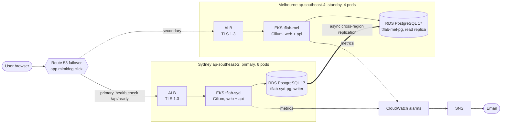
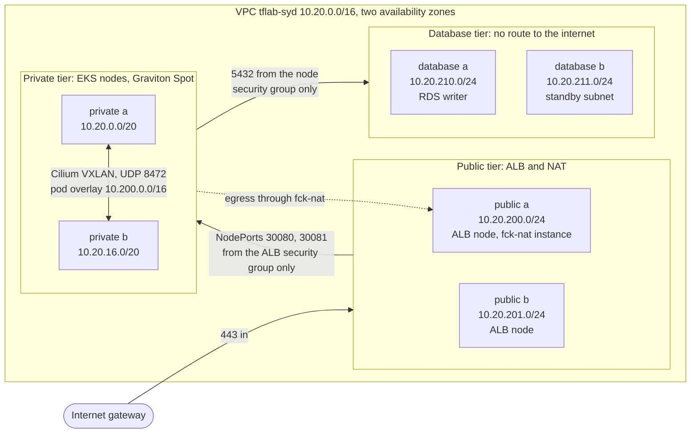
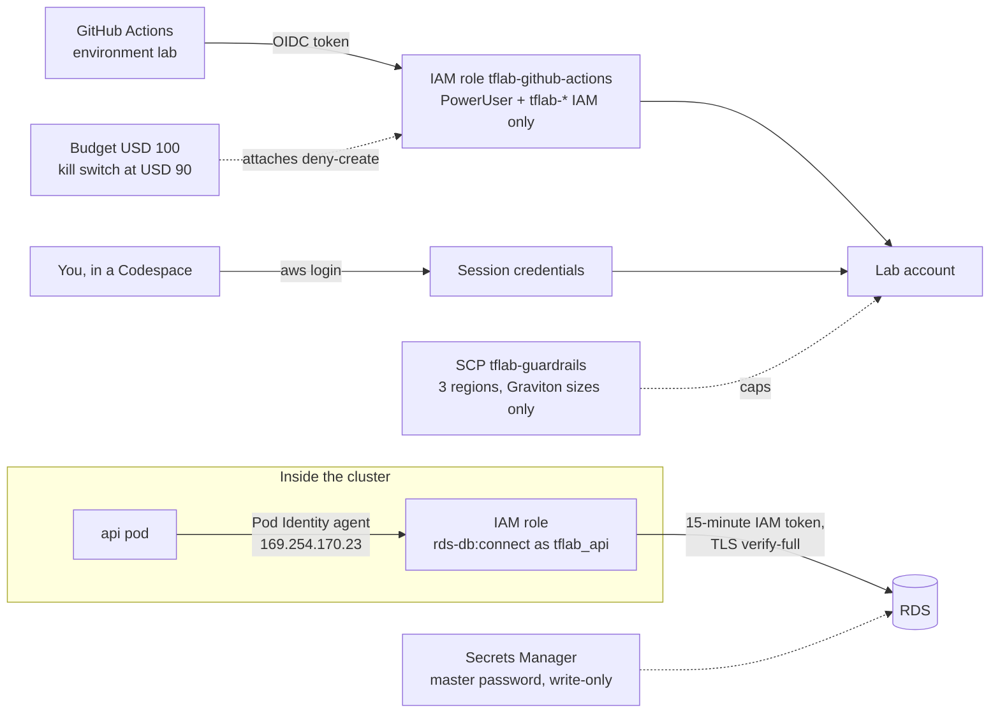
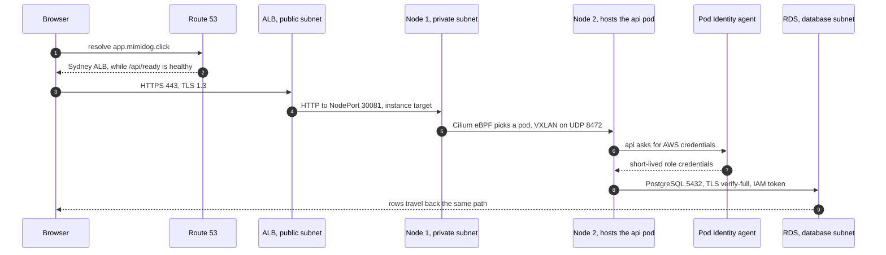
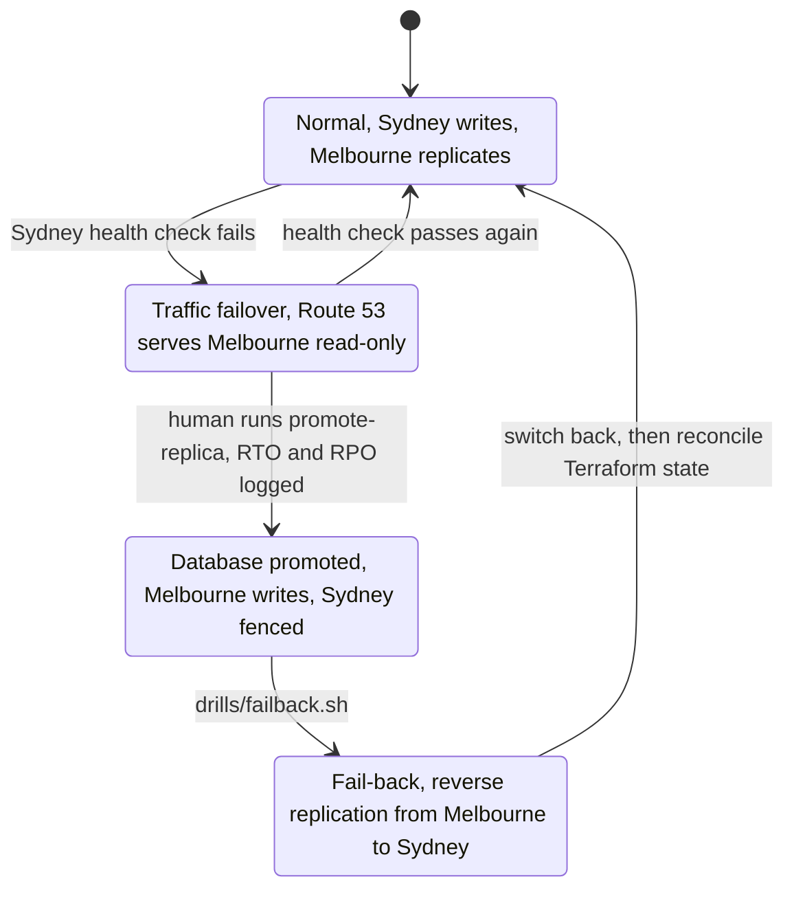
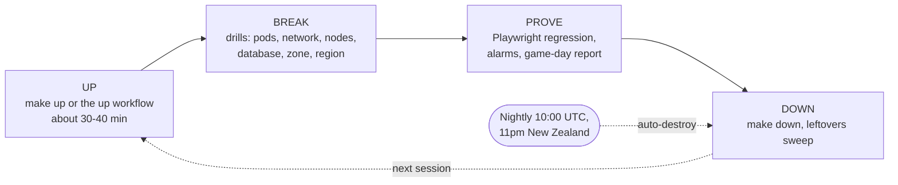

# tflab-aws

Two-region, active-passive Kubernetes lab on AWS, built to run on **USD 100 of credit**:

- **Sydney (ap-southeast-2) primary, Melbourne (ap-southeast-4) standby**: EKS 1.36 with Cilium (overlay CNI, kube-proxy replacement, Hubble), Graviton Spot nodes, max 10 app pods
- **React + .NET 10 API + RDS PostgreSQL**: IAM database auth, cross-region read replica, RTO/RPO 15 min
- **Route 53 failover** on `app.mimidog.click`, CloudWatch alarms -> email
- **Failure drills** for every layer (AWS FIS, Chaos Mesh, Cilium policies) and a **Playwright** regression suite
- **Ephemeral by design**: stand up, demo, tear down; nightly auto-destroy

Full guide: **[docs/PLAYBOOK.md](docs/PLAYBOOK.md)** · Agent skill: [.claude/skills/tflab-aws](.claude/skills/tflab-aws/SKILL.md)

## Architecture at a glance

Six diagrams, drawn in Mermaid so GitHub renders them here (hover a diagram for zoom and pan). The full reasoning lives in two interactive pages:

| Page | What it covers | Open |
|---|---|---|
| **Two-region EKS architecture** | Six views (request path, failover, data and DR, security, observe and break, cost) with zoom, pan and the decision behind each component | [Live page](https://mimidoro.github.io/tflab-aws/ARCH-tflabAWS-TwoRegionEKS-20261021.html) · [source](docs/ARCH-tflabAWS-TwoRegionEKS-20261021.html) |
| **Network and security** | Address plan, security groups, Cilium policies, encryption per hop, risks, from the VPC subnets down to the VXLAN tunnel | [Live page](https://mimidoro.github.io/tflab-aws/ARCH-tflabAWS-NetSec-20261021.html) · [source](docs/ARCH-tflabAWS-NetSec-20261021.html) |

Memory hook for the six diagrams: **SNAP-FL**, which stands for **S**ystem, **N**etwork, **A**ccess, **P**acket, **F**ailover, **L**ifecycle.

### 1. System: two regions, one name



### 2. Network: one VPC per region, three subnet tiers

Sydney shown; Melbourne is the same shape on `10.40.0.0/16` with pods on `10.201.0.0/16`.



### 3. Access: identity first, no stored keys



### 4. Packet: one API request, hop by hop



### 5. Failover: traffic first, then data



### 6. Lifecycle: UP-BREAK-PROVE-DOWN



### AWS console quick links

These links search by resource name, so they keep working after every rebuild (resource IDs change each time the lab comes up). Sign in to the lab account first.

| Resource | Sydney | Melbourne |
|---|---|---|
| EKS cluster | [tflab-syd](https://ap-southeast-2.console.aws.amazon.com/eks/home?region=ap-southeast-2#/clusters/tflab-syd) | [tflab-mel](https://ap-southeast-4.console.aws.amazon.com/eks/home?region=ap-southeast-4#/clusters/tflab-mel) |
| VPC | [VPCs](https://ap-southeast-2.console.aws.amazon.com/vpcconsole/home?region=ap-southeast-2#vpcs:search=tflab-syd) | [VPCs](https://ap-southeast-4.console.aws.amazon.com/vpcconsole/home?region=ap-southeast-4#vpcs:search=tflab-mel) |
| Subnets | [Subnets](https://ap-southeast-2.console.aws.amazon.com/vpcconsole/home?region=ap-southeast-2#subnets:search=tflab-syd) | [Subnets](https://ap-southeast-4.console.aws.amazon.com/vpcconsole/home?region=ap-southeast-4#subnets:search=tflab-mel) |
| Security groups | [Security groups](https://ap-southeast-2.console.aws.amazon.com/vpcconsole/home?region=ap-southeast-2#SecurityGroups:search=tflab-syd) | [Security groups](https://ap-southeast-4.console.aws.amazon.com/vpcconsole/home?region=ap-southeast-4#SecurityGroups:search=tflab-mel) |
| Load balancer | [tflab-syd-alb](https://ap-southeast-2.console.aws.amazon.com/ec2/home?region=ap-southeast-2#LoadBalancers:search=tflab-syd-alb) | [tflab-mel-alb](https://ap-southeast-4.console.aws.amazon.com/ec2/home?region=ap-southeast-4#LoadBalancers:search=tflab-mel-alb) |
| Nodes and NAT instance | [EC2 instances](https://ap-southeast-2.console.aws.amazon.com/ec2/home?region=ap-southeast-2#Instances:search=tflab-syd) | [EC2 instances](https://ap-southeast-4.console.aws.amazon.com/ec2/home?region=ap-southeast-4#Instances:search=tflab-mel) |
| Database | [tflab-syd-pg](https://ap-southeast-2.console.aws.amazon.com/rds/home?region=ap-southeast-2#database:id=tflab-syd-pg) | [tflab-mel-pg](https://ap-southeast-4.console.aws.amazon.com/rds/home?region=ap-southeast-4#database:id=tflab-mel-pg) |
| Alarms | [CloudWatch alarms](https://ap-southeast-2.console.aws.amazon.com/cloudwatch/home?region=ap-southeast-2#alarmsV2:?search=tflab) | [CloudWatch alarms](https://ap-southeast-4.console.aws.amazon.com/cloudwatch/home?region=ap-southeast-4#alarmsV2:?search=tflab) |
| Fault injection | [FIS templates](https://ap-southeast-2.console.aws.amazon.com/fis/home?region=ap-southeast-2#ExperimentTemplates) | not available in Melbourne |

Global: [Route 53 health checks](https://us-east-1.console.aws.amazon.com/route53/healthchecks/home) · [Route 53 hosted zones](https://us-east-1.console.aws.amazon.com/route53/v2/hostedzones) · [failover alarm, us-east-1](https://us-east-1.console.aws.amazon.com/cloudwatch/home?region=us-east-1#alarmsV2:?search=tflab) · [Budgets](https://us-east-1.console.aws.amazon.com/billing/home#/budgets)

## Quick start

```bash
# Tools: open in a GitHub Codespace (or VS Code dev container) - everything is pre-installed
./bootstrap/bootstrap.sh     # once per account (manual steps are explained inline)
make build && make up        # ~30-40 min, ~USD 0.50-0.70/hr while running
make drill                   # list failure drills
make test TARGET=app         # regression suite
make down                    # DRAIN teardown + leftovers sweep
```

Or use the GitHub Actions workflows: `up`, `drill`, `regression`, `down` (also nightly at 10:00 UTC).

## The live site (ONE-TWO-API)

While the lab is up you get a real HTTPS website. It stops answering after `down` or the nightly destroy, until the next `up`.

| URL | What you get |
|---|---|
| **https://app.mimidog.click** | **One** name for users: Route 53 sends you to Sydney, or to Melbourne during a failover |
| https://syd.mimidog.click | **Two** region-pinned names: Sydney (primary, writable) |
| https://mel.mimidog.click | Melbourne (standby, read-only until promoted) |

**The page shows** which region and pod served you, whether the database is writable, and a small form to add and list items.

**The API** (paths are the same on all three hostnames):

| Method | Path | Returns |
|---|---|---|
| GET | `/api/healthz` | `{"status":"ok"}` - process alive (ALB target health) |
| GET | `/api/ready` | `{"db":"ok","writable":true}`, or 503 when the DB is unreachable - Route 53 failover health check |
| GET | `/api/info` | region, pod, node, configured role, `dbWritable`, version |
| GET | `/api/items` | latest 50 items |
| GET | `/api/items/{id}` | one item, or 404 |
| POST | `/api/items` `{"text":"..."}` | 201 + item; 400 if empty or over 200 chars; 503 on a read-only standby |
| DELETE | `/api/items/{id}` | 204, 404, or 503 on a read-only standby |

```bash
curl -s https://app.mimidog.click/api/info  | jq     # region, pod, node, dbWritable
curl -s https://app.mimidog.click/api/items | jq     # latest 50 items
curl -s -X POST https://app.mimidog.click/api/items \
  -H 'Content-Type: application/json' -d '{"text":"hello"}'
```

**Watch it fail over:** run `drills/drill.sh failover syd --yes` (and `drills/rto-watch.sh` in a second terminal). The "Served by" region on the site flips to **Melbourne** within about 1-2 minutes, then fails back on its own.

## Glossary

ALB = Application Load Balancer · API = Application Programming Interface · DB = database · HTTPS = HTTP over TLS · CNI = Container Network Interface · EKS = Elastic Kubernetes
Service · FIS = Fault Injection Service · OIDC = OpenID Connect · RDS = Relational Database
Service · RPO / RTO = Recovery Point / Time Objective · SNS = Simple Notification Service.
Full glossary in the playbook.
