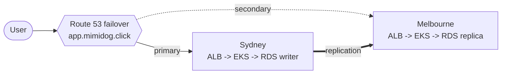

# tflab-aws

Two-region, active-passive Kubernetes lab on AWS, built to run on **USD 100 of credit**:

- **Sydney (ap-southeast-2) primary, Melbourne (ap-southeast-4) standby**: EKS 1.36 with Cilium (overlay CNI, kube-proxy replacement, Hubble), Graviton Spot nodes, max 10 app pods
- **React + .NET 10 API + RDS PostgreSQL**: IAM database auth, cross-region read replica, RTO/RPO 15 min
- **Route 53 failover** on `app.mimidog.click`, CloudWatch alarms -> email
- **Failure drills** for every layer (AWS FIS, Chaos Mesh, Cilium policies) and a **Playwright** regression suite
- **Ephemeral by design**: stand up, demo, tear down; nightly auto-destroy

Full guide: **[docs/PLAYBOOK.md](docs/PLAYBOOK.md)** · Agent skill: [.claude/skills/tflab-aws](.claude/skills/tflab-aws/SKILL.md)



## Quick start

```bash
./bootstrap/bootstrap.sh     # once per account (manual steps are explained inline)
make build && make up        # ~30-40 min, ~USD 0.50-0.70/hr while running
make drill                   # list failure drills
make test TARGET=app         # regression suite
make down                    # DRAIN teardown + leftovers sweep
```

Or use the GitHub Actions workflows: `up`, `drill`, `regression`, `down` (also nightly at 10:00 UTC).

## Glossary

ALB = Application Load Balancer · CNI = Container Network Interface · EKS = Elastic Kubernetes
Service · FIS = Fault Injection Service · OIDC = OpenID Connect · RDS = Relational Database
Service · RPO / RTO = Recovery Point / Time Objective · SNS = Simple Notification Service.
Full glossary in the playbook.
