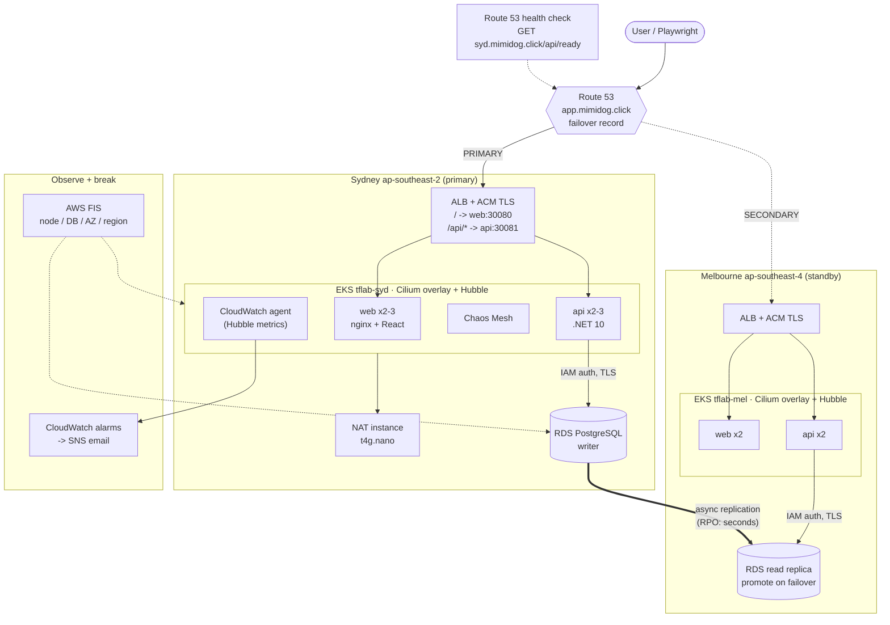
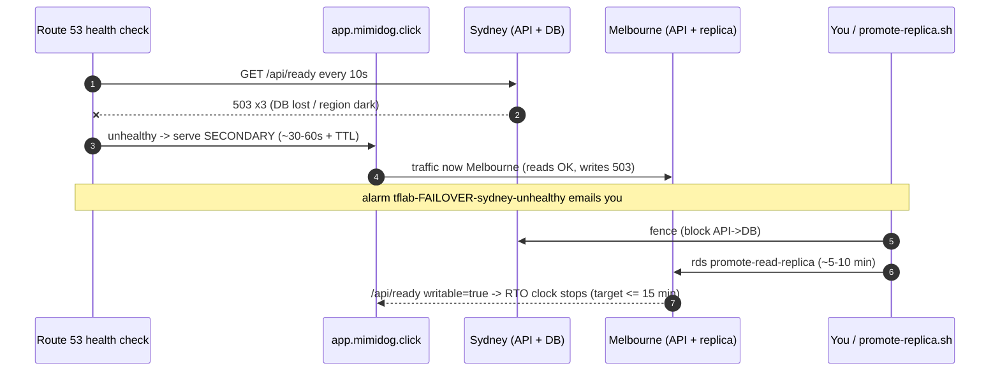
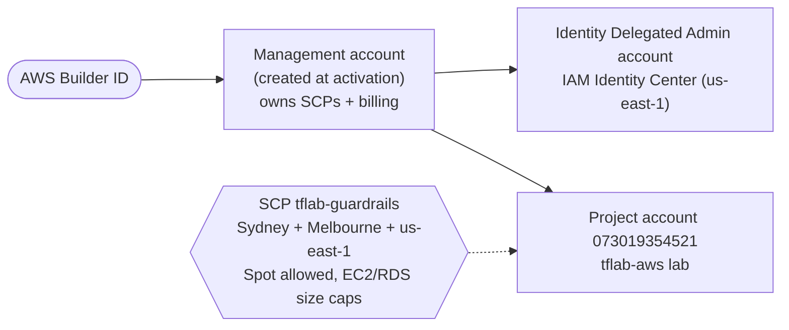

# tflab-aws Playbook

Two-region, active-passive Kubernetes lab on AWS for **USD 100 of credit**: stand it up with
Terraform, break every layer on purpose, watch CloudWatch alarms fire, prove RTO/RPO, tear it down.

> **Memory hooks used throughout:** **PACE-SCOT-STAR** (design decisions) · **BUILD-RIG** (setup) ·
> **UP-BREAK-PROVE-DOWN** (session) · **PANDA-R** (drills) · **DRAIN** (teardown).
> Diagrams are Mermaid: on GitHub, use the diagram's zoom / pan controls (or pinch on mobile).

---

## 1. Decisions (PACE-SCOT-STAR)

| Hook | Decision | Why |
|---|---|---|
| **P**attern | Ephemeral: up -> demo -> down, nightly auto-destroy | 24/7 two-region EKS would burn USD 100 in ~1-2 weeks |
| **A**ctive mode | Active-passive: Sydney primary, Melbourne standby | Meets 15-min RTO/RPO at a fraction of active-active cost |
| **C**hoice of DB | RDS PostgreSQL 17, db.t4g.micro + cross-region read replica | SQL Server cross-region DR needs Enterprise; Aurora Global minimums blow the budget |
| **E**xpense guard | Paid plan + budget alerts 25/50/75/100% + USD 90 kill switch | Bill risk capped; credits still applied first |
| **S**izing | 2 EKS clusters; up to 6 app pods Sydney (3 web + 3 api), 4 Melbourne (2 + 2) = max 10 | Two control planes = USD 0.20/hr; more clusters add cost, not learning |
| **C**ilium | Full CNI replacement, overlay (VXLAN) mode, kube-proxy replacement, Hubble | Requested "CNI replacement without ENI mode" |
| **O**utage simulation | AWS FIS + Chaos Mesh + scripted Cilium/RDS drills | AWS-level, pod-level and app-level faults |
| **T**esting | Playwright (API + UI) + GitHub Actions with OIDC | One toolchain, no stored AWS keys |
| **S**kill | `.claude/skills/tflab-aws/` in this repo | Versioned with the code, improved by PR |
| **T**raffic entry | Route 53 failover on `app.mimidog.click` | USD 3/yr domain; health-checked regional failover |
| **A**lerts | Email via SNS to cwdyang888@gmail.com | One confirmation click per topic |
| **R**epo | PR-based changes to `mimidoro/tflab-aws` | Review gate before anything touches AWS |

**Recommendation recap:** Winner = this design. Runner-up = single region, multi-AZ (half the
cost, but no regional DR story). Avoid = Aurora Global / multi-region active-active (budget), and
managed NAT Gateways (~USD 0.06/hr each - replaced by a NAT instance).

---

## 2. Architecture

**Interactive version:** `docs/ARCH-tflabAWS-TwoRegionEKS-20261021.html` - open it in a browser for six views (request path, failover, data and DR, security, observe and break, cost), zoom/pan, and the reasoning plus first-build lessons for every component.



**Request path:** browser -> Route 53 -> regional ALB (TLS) -> node NodePort -> Cilium eBPF
service -> pod (VXLAN overlay if on another node). Pod IPs come from Cilium's own pool
(10.200.0.0/16 Sydney, 10.201.0.0/16 Melbourne) and are not VPC-routable, so the ALB targets
nodes (instance mode) and webhook servers run on the host network.

### Failover sequence



---

## 3. Cost model (estimates, Sydney/Melbourne list prices)

| Item | While up (per hour) | While down |
|---|---|---|
| 2 x EKS control plane | ~0.20 | 0 |
| 4 x Graviton Spot nodes (t4g.medium class) | ~0.06-0.08 | 0 |
| 2 x ALB (+ LCUs at lab traffic) | ~0.06 | 0 |
| 2 x RDS db.t4g.micro (writer + replica) + storage | ~0.05 | 0 |
| 2 x NAT instance + public IPv4 addresses | ~0.03 | 0 |
| CloudWatch logs/metrics/alarms, FIS minutes, Route 53 health check | ~0.02-0.05 | cents/month |
| **Total** | **~0.45-0.70 / hr** | **~USD 0.50/month + domain USD 3/yr** |

USD 100 of credit = roughly **150-200 lab hours**. Domain registration is usually charged to the
card, not the credits. Verify real spend in Cost Explorer (filter tag `Project = tflab-aws`).

---

## 4. Setup - manual vs scripted (A-BUILD-RIG)

**Repeatable sequence:** follow `.claude/skills/tflab-aws/setup.md` (the golden path: TOOLS-ACCOUNT-ORG-LOGIN-BOOT-UP-PROVE), validated end to end on 2026-10-21. The tables below are the reference.

Run `./bootstrap/bootstrap.sh` from the repo root; each manual step is mirrored as comments in the script.

### Account model: AWS "project" account

The lab account (073019354521) was created through the **new AWS experience** (AWS Builder ID,
`AccountFullAccessRole`). Until advanced features are activated, AWS-managed service control
policies (SCPs) allow **one workload region only**, **deny Spot**, **deny creating IAM Identity
Center** and block region opt-in. Decision (2026-10-21): **activate advanced features** to keep the
two-region design. This is **irreversible** and removes AWS's hard spend limit; the B2 budget kill
switch and nightly destroy replace it.

| Account | ID | Role | How to reach it |
|---|---|---|---|
| Management | 996241422033 | Organization, SCPs, billing | settings.aws.com (Builder ID) > management links; root = emergencies only (set password via *Forgot password*, add MFA) |
| Identity Delegated Admin | (created at activation) | IAM Identity Center `mimido-team`, us-east-1 | settings.aws.com |
| Lab project | 073019354521 | tflab-aws workloads | settings.aws.com > Projects > open console; CLI `aws login --remote` |
| Other project ("Ready Set Build") | - | not part of the lab - but `tflab-guardrails` on Root applies to it too | settings.aws.com |

Checked 2026-10-21: after activation **no SCP denies Spot**; only the region-restriction policy had
to be swapped. `sso:CreateInstance` stays denied (Identity Center already exists).



| # | Step | Manual (console) | Scripted |
|---|---|---|---|
| M0 | **A**ctivate | settings.aws.com > Projects > Actions > Explore advanced features; team name; new management email (e.g. `cwdyang888+aws-mgmt@gmail.com`); add MFA to the new management root user | - (irreversible decision) |
| M0b | **A**ctivate: guardrails | Management account (reach it via settings.aws.com, not root) > Organizations > Policies > SCPs: create `tflab-guardrails`, attach to **Root**, then detach `AdvancedModeRegionRestrictionSecurityControlPolicy`. Keep `ManagedAccountSecurityControlPolicy`, `FullAWSAccess`, `BudgetsSpendLimit*` | `./bootstrap/org-guardrails.sh --apply` (run in the management account) |
| M1 | **B**udget | Billing > Budgets: USD 100, credits excluded, 25/50/75/100% alerts | B2 creates `tflab-aws-guard`; delete the manual one afterwards |
| M2 | **U**pgrade | Billing > Free Tier > Upgrade plan | - (account decision) |
| M3 | **I**dentity | Open the lab account console via settings.aws.com > Projects (never root) | `aws login --remote --profile tflab-admin` (AWS CLI >= 2.32); region prompt = `ap-southeast-2`; pick the **lab account** session (`073019354521`), not the management account; bootstrap refuses the management account. Runner-up: Identity Center from M0 (us-east-1) + `aws configure sso` |
| M4 | **L**ocation | Account > AWS Regions > enable Melbourne | `aws account enable-region` + wait |
| M5 | **D**omain | Route 53 > Register `mimidog.click`; click ICANN email | `register-domain` command in comments |
| B1 | **R**emote state | S3 bucket, versioned, encrypted, TLS-only | yes |
| B2 | **I**AM/ECR/guard | IAM OIDC provider + role, ECR, SNS, Budgets | `terraform -chdir=bootstrap apply` |
| M6 | (inbox) | Confirm SNS subscription emails | - |
| B3 | **G**itHub | Settings > Environments > `lab` (main only); variable `AWS_ACCOUNT_ID` | `gh api` / `gh variable set` |
| M7 | (optional) | Required reviewer on `lab` | - |

Tooling: `aws` v2 (>= 2.32 for `aws login`), `terraform` >= 1.10, `kubectl`, `helm`, `gh`, `jq`, Node 22, .NET 10 - **all pre-installed in the dev container** (`.devcontainer/`: open in GitHub Codespaces or VS Code "Reopen in Container").

- The dev container only exists on branches that contain `.devcontainer/` - create the codespace from `main` after merging.
- After pulling dev container changes into an existing codespace: Command Palette (Ctrl/Cmd+Shift+P) > **Codespaces: Full Rebuild Container**, or delete it at github.com/codespaces and create a new one.
- In a codespace, run `unset GITHUB_TOKEN && gh auth login` before bootstrap (step B3 needs repo admin rights; the built-in codespace token doesn't have them).
- Old IAM users with access keys (e.g. `svc-github-deploy`) are not used - GitHub deploys via OIDC. Bootstrap warns about any active keys; deactivate and delete them.

---

## 5. Session loop (UP-BREAK-PROVE-DOWN)

| Step | GitHub | Local |
|---|---|---|
| **UP** | Actions > `up` > Run workflow | `make build && make up && make kubeconfig` |
| **BREAK** | Actions > `drill` | `make drill DRILL=db-block REGION=syd` |
| **PROVE** | Actions > `regression` | `make test TARGET=app` |
| **DOWN** | Actions > `down` (also nightly 10:00 UTC) | `make down` |

### The live site (ONE-TWO-API)

While the lab is up you get a real HTTPS website. It stops answering after `down` or the nightly destroy, until the next `up`.

| URL | What you get |
|---|---|
| **https://app.mimidog.click** | **One** name for users: Route 53 sends you to Sydney, or to Melbourne during a failover |
| https://syd.mimidog.click | **Two** region-pinned names: Sydney (primary, writable) |
| https://mel.mimidog.click | Melbourne (standby, read-only until promoted) |

**The page shows** which region and pod served you, whether the database is writable, and a small form to add and list items.

**The API** (paths are the same on all three hostnames):

| Method | Path | Returns |
|---|---|---|
| GET | `/api/healthz` | `{"status":"ok"}` - process alive (ALB target health) |
| GET | `/api/ready` | `{"db":"ok","writable":true}`, or 503 when the DB is unreachable - Route 53 failover health check |
| GET | `/api/info` | region, pod, node, configured role, `dbWritable`, version |
| GET | `/api/items` | latest 50 items |
| GET | `/api/items/{id}` | one item, or 404 |
| POST | `/api/items` `{"text":"..."}` | 201 + item; 400 if empty or over 200 chars; 503 on a read-only standby |
| DELETE | `/api/items/{id}` | 204, 404, or 503 on a read-only standby |

```bash
curl -s https://app.mimidog.click/api/info  | jq     # region, pod, node, dbWritable
curl -s https://app.mimidog.click/api/items | jq     # latest 50 items
curl -s -X POST https://app.mimidog.click/api/items \
  -H 'Content-Type: application/json' -d '{"text":"hello"}'
```

**Watch it fail over:** run `drills/drill.sh failover syd --yes` (and `drills/rto-watch.sh` in a second terminal). The "Served by" region on the site flips to **Melbourne** within about 1-2 minutes, then fails back on its own.

### Look inside a cluster (NCH: Nodes, Cilium, Hubble)

There is no hosted dashboard; everything is reached from the codespace with your own sign-in
(`aws login --remote --profile tflab-admin`). Your console role (`AccountFullAccessRole`) is an
EKS cluster admin via access entries, so kubectl, Hubble and the EKS console all work.

```bash
make kubeconfig              # contexts tflab-syd, tflab-mel
make observe REGION=syd      # nodes (AZ, type, Spot), pods per node, cilium status, HPA, last drops
make hubble REGION=syd       # Hubble UI on :12000 (Codespaces: Ports tab > 12000 > open in browser)
scripts/observe.sh syd flows # live flows in namespace app
scripts/observe.sh syd drops # live dropped flows only (try during drills/drill.sh db-block)
```

| Question | Where |
|---|---|
| How many nodes, which AZ, Spot or On-Demand? | `make observe` (top table); EKS console > cluster > Compute |
| Is Cilium healthy on every node? | `cilium --context tflab-syd status` |
| Who talks to whom, what got dropped and why? | Hubble UI (service map + flow table) or `hubble observe --verdict DROPPED` |
| Pod scaling | `kubectl --context tflab-syd -n app get hpa -w` |
| Alarms and metrics | CloudWatch > Alarms (Sydney, Melbourne, us-east-1); metrics namespace `tflab/Cilium` |

#### Encrypted traffic

| Hop | Encrypted? | What you can see |
|---|---|---|
| Browser -> ALB | yes, TLS 1.2/1.3 (ACM cert) | ALB metrics / alarms; contents never |
| ALB -> node -> pod | no (HTTP inside the VPC) | Hubble flows: source, destination, port, verdict |
| Pod -> pod across nodes | no - VXLAN overlay, not encrypted | Hubble flows |
| API -> RDS | yes, TLS verify-full + IAM auth token | Hubble shows the TCP 5432 flow (to the VPC CIDR); contents never |

Hubble shows flow **metadata** (who, where, port, allowed/dropped), not payloads - and nothing can
read TLS payloads without the keys, which is the point. To encrypt pod-to-pod traffic too, enable
Cilium WireGuard transparent encryption (`encryption.enabled=true`, `encryption.type=wireguard` in
`k8s/values/cilium.yaml.tftpl`; check with `cilium --context tflab-syd encrypt status`). That is
backlog item 4 in `.claude/skills/tflab-aws/improve.md`.

---

## 6. Drill catalogue (PANDA-R)

| Layer | Drill | Tool | Alarm(s) expected | Recovery |
|---|---|---|---|---|
| **P**od | pod-kill | Chaos Mesh | none (PDB + replicas) | seconds |
| **P**od | web-down | Chaos Mesh | web-unhealthy-targets, alb-no-healthy-targets | 3 min |
| **P**od | cpu-stress | Chaos Mesh | none; HPA scales out | 5 min |
| **A**pp | latency | Chaos Mesh | api-latency-p95 | 5 min |
| **A**pp->DB | db-block | Cilium deny policy | cilium-packet-drops, alb-target-5xx (+ failover in Sydney) | 5 min auto |
| **N**ode | node-kill | AWS FIS | unhealthy-targets, cilium-unreachable-nodes | ASG ~5 min |
| **D**B | db-reboot | AWS FIS | alb-target-5xx | 2-5 min |
| **A**Z | az-blackout | AWS FIS | unhealthy-targets (one AZ) | 5 min |
| **R**egion | failover | Cilium + Route 53 | us-east-1 `tflab-FAILOVER-sydney-unhealthy` | auto fail-back |
| **R**egion | region-blackout | AWS FIS | as above + unhealthy targets | 10 min |
| **D**B | promote-replica | RDS API | RTO/RPO report | rebuild (down + up) |

**AWS FIS drills run in Sydney only** - FIS has no endpoint in Melbourne (ap-southeast-4); Melbourne uses the Chaos Mesh, Cilium and RDS-API drills.

**RTO evidence:** `drills/rto-watch.sh` (time until traffic moves, time until writes work).
**RPO evidence:** `promote-replica` writes a marker in Sydney, fences Sydney, promotes Melbourne
and checks the marker survived; replica lag is printed before fencing.

---

## 7. Alarm catalogue

| Alarm | Region | Metric | Fires when |
|---|---|---|---|
| `<r>-alb-target-5xx` | each | ALB HTTPCode_Target_5XX_Count | > 5 in 1 min, 2 periods |
| `<r>-alb-no-healthy-targets` | each | ALB HTTPCode_ELB_5XX_Count | > 3 in 1 min |
| `<r>-api-unhealthy-targets` / `-web-` | each | UnHealthyHostCount | >= 1 |
| `<r>-api-latency-p95` | each | TargetResponseTime p95 | > 1 s, 2 periods |
| `<r>-db-cpu-high` | each | RDS CPUUtilization | > 80%, 3 periods |
| `<r>-db-storage-low` | each | RDS FreeStorageSpace | < 2 GiB |
| `tflab-mel-db-replica-lag-RPO-risk` | Melbourne | RDS ReplicaLag | > 300 s, 3 periods |
| `<r>-cilium-packet-drops` | each | RATE(hubble_drop_total) | > 1/s, 2 periods |
| `<r>-cilium-unreachable-nodes` | each | cilium_unreachable_nodes | > 0, 2 periods |
| `tflab-FAILOVER-sydney-unhealthy` | us-east-1 | Route 53 HealthCheckStatus | < 1 |
| Budget 25/50/75% actual, 100% forecast | global | AWS Budgets (net of credits) | thresholds |

---

## 8. Teardown (DRAIN)

| Step | What |
|---|---|
| **D**etach chaos | stop FIS experiments, delete Chaos Mesh experiments + drill policies |
| **R**elease Helm | drop Helm releases from state for clusters already gone |
| **A**pply destroy | `terraform destroy` (replica before primary), one automatic retry |
| **I**nspect | `scripts/leftovers.sh` - fails if EKS/RDS/ALB/EC2/EBS/EIP/NAT/tagged resources remain |
| **N**otify | result emailed via `tflab-ops` |

**Teardown troubleshooting:** VPC deletion blocked -> look for ENIs in the VPC
(`aws ec2 describe-network-interfaces --filters Name=vpc-id,Values=<vpc>`), delete detached ones,
re-run `make down`. KMS keys enter a 7-day pending deletion (no charge).

---

## 9. Kill switch tripped

At USD 90 net spend the budget action attaches `tflab-deny-create` to `tflab-github-actions`:
creates are denied, destroys still work.

1. Run `down` (it still works) and confirm `CLEAN`.
2. Review Cost Explorer; decide whether to continue.
3. To re-enable: Budgets > `tflab-aws-guard` > Actions > select the action > **Reset**, or
   IAM > Roles > `tflab-github-actions` > detach `tflab-deny-create` (as admin).

---

## 10. Security and data posture

| Concern | Position |
|---|---|
| **Data classification** | Synthetic test data only (`items` table). Never load client or SkyCity data into this lab. |
| **Origin -> processing -> storage** | Browser -> ALB (TLS 1.2/1.3) -> pods -> RDS (TLS verify-full, encrypted storage). State in S3 (SSE, versioned, TLS-only). |
| **Identity** | GitHub OIDC -> role pinned to repo + `lab` environment (main only). Pods use EKS Pod Identity. API uses IAM DB auth - no app password exists. Master password generated ephemerally and written only to the DB and Secrets Manager secret `tflab-syd-pg-master` via write-only arguments (never in Terraform state); read only by the `db-init` Job. (RDS-managed master passwords block cross-region replicas for PostgreSQL.) |
| **Least privilege** | Deploy role = PowerUser + IAM limited to `tflab-*`, cannot modify itself or the kill switch, cannot attach admin policies. Pod roles scoped to one DB user / one secret / CloudWatch agent. Cilium policies default-deny pod egress. |
| **Secrets** | None in git, none in GitHub (only the account ID variable). |
| **Exposure** | Public: ALB 80/443 and the EKS API endpoint (IAM-authenticated; narrow `api_allowed_cidrs` to your IP for extra safety). RDS private. |
| **Retention** | EKS/app logs 1 day, RDS backups 1 day, ECR last 10 images, state versions 30 days. |
| **Audit** | EKS api/audit/authenticator logs; CloudTrail event history (90 days, default). |
| **Supply chain** | Pinned Helm charts and Terraform module majors; images built from source in CI; ECR scan on push. Gaps: Actions pinned by tag, CloudWatch agent `latest` (backlog #1). |
| **Production changes** | N/A - lab only. Every change is reversible by `down` + `up`. |

### Hardening backlog (lab -> production gaps)

Single NAT instance per region · single-AZ RDS writer · FIS stop condition "none" · public EKS
endpoint · Actions/agent not digest-pinned · no WAF on ALB · no ALB access logs · no VPC flow
logs. See `.claude/skills/tflab-aws/improve.md` for the prioritised list.

---

## 11. Repository map

```
bootstrap/        one-time account setup (state bucket script, OIDC role, ECR, budget guard)
infra/            two-region stack: modules/core (AWS) + modules/platform (Helm, nodes, FIS)
k8s/              Helm charts (app, cwagent) and values (Cilium, Chaos Mesh)
app/              React web (nginx) and .NET 10 API
chaos/            Chaos Mesh experiments + Cilium drill policy
drills/           drill.sh (PANDA-R), rto-watch.sh, promote-replica.sh
scripts/          up.sh, down.sh (DRAIN), leftovers.sh, kubeconfig.sh, observe.sh (NCH)
tests/regression/ Playwright API + UI suite
.claude/skills/   tflab-aws agent skill
.github/workflows ci, build, up, down (nightly), drill, regression
```

---

## 12. Glossary

| Term | Meaning |
|---|---|
| ACM | AWS Certificate Manager - issues the TLS certificates on the ALBs |
| ALB | Application Load Balancer |
| ASG | Auto Scaling Group - keeps the node count |
| AZ | Availability Zone - an isolated data centre group within a region |
| CIDR | Classless Inter-Domain Routing - an IP address range, e.g. 10.20.0.0/16 |
| CNI | Container Network Interface - the plugin that gives pods their network (Cilium here) |
| CSP | Content Security Policy - browser header limiting what a page may load |
| DR | Disaster Recovery |
| eBPF | extended Berkeley Packet Filter - in-kernel programs Cilium uses for networking and policy |
| ECR | Elastic Container Registry |
| EKS | Elastic Kubernetes Service |
| EMF | Embedded Metric Format - log lines CloudWatch turns into metrics |
| ENI | Elastic Network Interface |
| FIS | AWS Fault Injection Service |
| HA | High Availability |
| HPA | Horizontal Pod Autoscaler |
| Hubble | Cilium's flow observability layer |
| IAM | Identity and Access Management |
| ICANN | Internet Corporation for Assigned Names and Numbers - requires registrant email verification |
| KMS | Key Management Service |
| LCU | Load Balancer Capacity Unit - ALB usage billing unit |
| mTLS | mutual TLS - both sides present certificates |
| NAT | Network Address Translation - lets private nodes reach the internet |
| NodePort | Kubernetes Service type exposing a fixed port on every node |
| OIDC | OpenID Connect - lets GitHub Actions get short-lived AWS credentials |
| PDB | PodDisruptionBudget |
| RDS | Relational Database Service |
| RPO | Recovery Point Objective - max acceptable data loss (15 min here) |
| RTO | Recovery Time Objective - max acceptable time to restore service (15 min here) |
| SNS | Simple Notification Service |
| SPA | Single-Page Application |
| Spot | Spare EC2 capacity at a discount; can be reclaimed with 2 minutes' notice |
| SSO | Single Sign-On (IAM Identity Center) |
| TTL | Time To Live - how long DNS answers are cached |
| VPC | Virtual Private Cloud |
| VXLAN | Virtual Extensible LAN - the tunnel Cilium uses between nodes in overlay mode |
| WireGuard | Modern VPN protocol; Cilium can use it to encrypt pod-to-pod traffic transparently |
